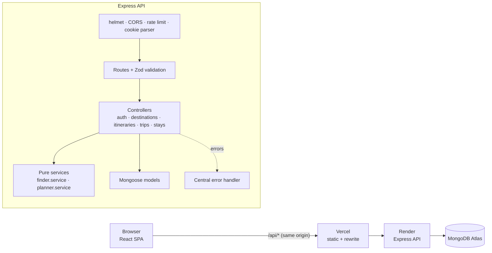

# Roamly

**Two days, a budget, starting in Bengaluru. Roamly ranks places that actually fit, drafts the days, and finds people to go with.**

**Live app:** https://roamly-roam-freely.vercel.app
**API:** https://roamly-api-3wvo.onrender.com/api/health (free tier, so the first request after a quiet spell can take up to a minute)
**Demo video:** (https://drive.google.com/file/d/1EVPPg2vPwgPvvCOn5Hf4c2d9f6E7Pkm0/view?usp=sharing)
Demo login: use **"Use the demo account"** on the login page (`demo@roamly.app` / `roamly-demo-2026`).

---

## Problem statement

Planning a short trip out of Bengaluru means juggling questions no single site answers together: *Can I get there and back in two days? Will ₹4,000 cover it? Will I arrive at 3 am? Is there anything there for me? Who else is going?* Travel sites list places by popularity and leave the maths to you. Solo travellers, and especially women travelling alone, also have to work out whether a plan is sensible, not just whether it exists.

## Target users

- Students and young professionals in Bengaluru with a free weekend and a fixed budget.
- Solo travellers who want company: people willing to join a small group of strangers rather than not go.
- Hosts organising a trip who need a few more people to split costs.

## Solution

Roamly turns the questions into a sentence ("I have **2 days** and **₹4,000**, going **solo** by **bus**") and does the work on the server:

1. **Trip Finder** works out a realistic journey for every destination (day travel or overnight bus, departure and arrival times, hours left to explore), estimates the cost per person with every assumption shown, rules out places that can't work, and ranks the rest with a breakdown of *why*.
2. **Itineraries** drafts day-by-day plans from visit durations, travel time between stops, sunrise and sunset spots and opening hours where known. You can reorder stops, move them between days and save the plan to your account. The server recomputes the times after every edit.
3. **Group trips:** host a trip with dates, seats, a budget and an optional women-only setting. Others request a seat and the host approves. Seat limits, duplicate requests, date rules and overlapping trips are enforced on the server, including under concurrent requests.
4. **Stays and reviews:** itemised price quotes and declared safety features. Only people who completed a Roamly trip to that destination can review its stays, once.

## Key features

| Workflow | What users can do | Rules enforced on the server |
|---|---|---|
| Find a trip | Set days, budget, group, mode, interests, crowd preference, "arrive in daylight"; see ranked, explained results and what was ruled out | Travel-time feasibility, budget cap (+15% stretch), interest match, dark-arrival filter, input validation |
| Plan the days | Draft, drag to reorder, move between days, add or remove stops, save, rename, delete | Stops must belong to the destination, no duplicates, day count fixed, owner-only access (404 for others) |
| Group trips | Browse and filter, host, request with a note, withdraw, approve or decline, cancel | Host-only decisions, atomic seat reservation, one request per person (unique index), no requests after start, women-only rules, no overlapping trips |
| Stays and reviews | Price for N nights and guests, dorm alternative, declared safety, verified reviews | Review only after a completed trip there, one per stay, ratings re-aggregated |
| Accounts | Register, log in, demo account, log out | bcrypt hashing, httpOnly JWT cookie, rate-limited auth, equal-time login failures |

## Tech stack

| Layer | Choice | Why |
|---|---|---|
| Frontend | React 19, Vite, React Router 7 | Component model plus fast dev/build; routes are code-split |
| Server state | TanStack Query | Caching, retries, keeping previous results while re-ranking |
| Styling | Tailwind CSS v4 with design tokens | Tokens in one place (`client/src/index.css`, documented in `DESIGN.md`) |
| Motion | Motion (Framer Motion) | Layout animation for re-ranking, drag-to-reorder for itineraries |
| Backend | Node.js 24, Express 5 | Async errors propagate to one error handler without wrappers |
| Validation | Zod 4 | One schema validates, coerces and documents each request |
| Database | MongoDB Atlas, Mongoose 9 | Nested itinerary and attraction data fits documents; unique indexes and conditional updates give concurrency safety |
| Auth | JWT in httpOnly cookie, bcrypt | No token in JavaScript-readable storage |
| Tests | `node:test`, Supertest, mongodb-memory-server | Real Express app against a real (in-memory) MongoDB |
| Hosting | Vercel (client), Render (API) | Vercel rewrites `/api` to Render, so cookies stay first-party |

## Architecture



**Server** (`server/src`), organised by feature:

```
config/         env validation (fails fast), DB connection (in-memory in dev)
middleware/     auth (requireAuth / optionalAuth), validate (Zod), errorHandler
modules/
  auth/           user model, register/login/logout/me
  destinations/   model, finder.service.js  ← ranking engine (pure functions)
  itineraries/    model, planner.service.js ← day planner (pure functions)
  trips/          trip + join-request models, seat/request rules
  stays/          stay + review models, quotes, review eligibility
seed/           destinations.json (built from Wikipedia) + demo data
scripts/        build-destinations.js, the data pipeline
test/           unit tests (finder) and API tests (all workflows)
```

**Client** (`client/src`): `features/` (finder, itinerary, trips, stays, auth) hold hooks and components per workflow, `pages/` compose them, and `components/` holds the shared design-system pieces (Milestone, Photo, states, toast).

### Engineering decisions worth knowing

- **The ranking and planning logic are pure functions** (`finder.service.js`, `planner.service.js`). They take data and preferences and return results with explanations, so they can be unit-tested without a database and every rule is readable in one place.
- **Seats can't be oversold.** Approval reserves a seat with one conditional update (`seatsTaken < seats`, caller is host, trip not started), then flips the request from `pending` to `approved` conditionally. If the second step fails, the seat is released. A test fires three simultaneous approvals at a one-seat trip and asserts exactly one succeeds.
- **Duplicate requests are blocked by the database**, with a unique `(trip, user)` index, not just a check-then-insert. This is also tested with simultaneous requests.
- **Itinerary times are never stored.** Only the order of stops is saved; the server recomputes the timeline on every read, so a saved plan can't contradict the planner's rules.
- **Authorization returns 404, not 403**, for other people's itineraries and trips you don't host, so it doesn't confirm that a resource exists.
- **Errors have one shape** (`{ error: { message, details? } }`). Validation errors carry field names so forms show messages next to the right input; unexpected errors never leak internals in production.
- **Preferences live in the URL**, so finder searches are shareable and survive refresh and the back button.

## Data: sources and honesty

- **Places, attractions, coordinates and photos** come from Wikipedia and Wikimedia Commons via `server/scripts/build-destinations.js`. Each photo shows its author and licence; each description links to its source. Attractions described only inside a town's article are linked to it, without borrowing its text.
- **Editorial estimates** (road distance, crowd level, cost tier, suggested visit time, direct-bus availability) are curated in `server/scripts/destinations.spec.js` and **labelled as estimates** throughout the UI.
- **Opening hours** are shown only where commonly published, with "confirm locally". Everything else says "not verified".
- **Stays are sample listings** that show how listings work; they are labelled as such and are not real properties. Their safety items are shown as *declared by the listing*. **No reviews are seeded.**
- **Demo trips** are labelled "Sample trip". Requests and approvals on them are real and saved.

## Local setup

Requirements: Node.js 20.6+ (24 recommended). No MongoDB install needed for development.

```bash
git clone <repo-url> roamly && cd roamly

# API (http://localhost:4000)
cd server
cp .env.example .env
node -e "console.log('JWT_SECRET=' + require('crypto').randomBytes(48).toString('hex'))" >> .env
npm install
npm run dev        # no MONGO_URI → starts an in-memory MongoDB and seeds it

# Client (http://localhost:5173), in a second terminal
cd client
npm install
npm run dev        # proxies /api to localhost:4000
```

Run the tests with `cd server && npm test`. There are 21 tests: finder unit tests, plus API tests for auth, itineraries, trips (including concurrency) and reviews.

## Environment variables

`server/.env` (see `server/.env.example`):

| Variable | Required | Purpose |
|---|---|---|
| `JWT_SECRET` | yes | Signs session tokens; at least 32 characters |
| `MONGO_URI` | in production | MongoDB connection string. Empty in development means an in-memory DB |
| `NODE_ENV` | no | `development` (default) or `production` (secure cookies, no error details) |
| `PORT` | no | Default 4000 |
| `CLIENT_ORIGIN` | no | Allowed browser origin(s), comma-separated |
| `JWT_EXPIRES_IN` | no | Default `7d` |
| `TRUST_PROXY` | no | Proxy hops in front of the API; `2` on Render behind Vercel |

The client needs no environment variables: it calls `/api` on its own origin.

## Deployment

1. **MongoDB Atlas:** create a free cluster and a database user, allow access from anywhere (`0.0.0.0/0`, since Render's IPs vary), and copy the connection string.
2. **Seed it once** from your machine: put `MONGO_URI=<atlas uri>` in `server/.env`, then run `cd server && npm run seed`.
3. **Render:** create a Blueprint from this repo (`render.yaml`). Set `MONGO_URI` and `CLIENT_ORIGIN` (your Vercel URL); `JWT_SECRET` is generated. Check `https://<service>.onrender.com/api/health`.
4. **Vercel:** import the repo with root directory `client` (framework Vite). `client/vercel.json` forwards `/api/*` to the Render service; change that URL if your Render service has a different name.

Render's free tier sleeps when idle; the first request after a while can take up to a minute.

## Known limitations and next steps

- Origins: only Bengaluru so far. The data model already keys journeys by origin.
- Road distances and travel times are estimates; next is a routing API and live bus timetables.
- Stays are sample listings; next is verified host onboarding.
- Group chat, notifications for request decisions, and photo uploads are planned after submission.

## Credits

Place summaries: Wikipedia contributors (CC BY-SA 4.0). Photos: individual Wikimedia Commons authors, credited on each image. Built by Darshana Jain with AI assistance (Claude) for implementation, as allowed by the project guidelines (§15).
# ROAMLY-Roam-Freely-
